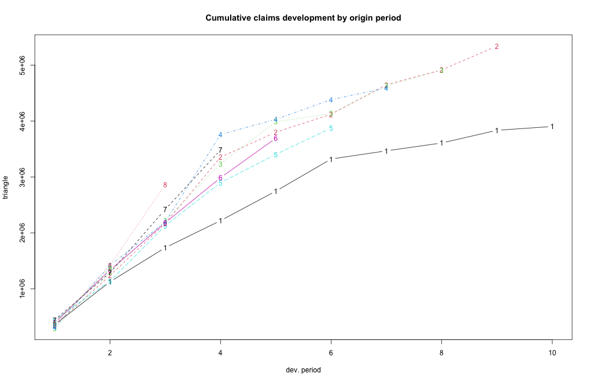
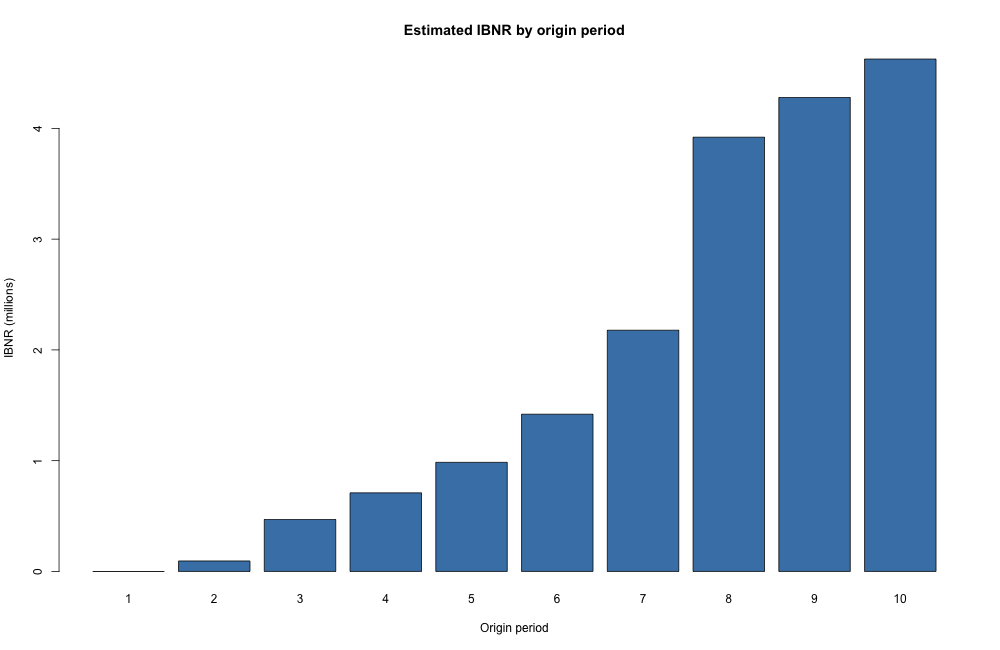
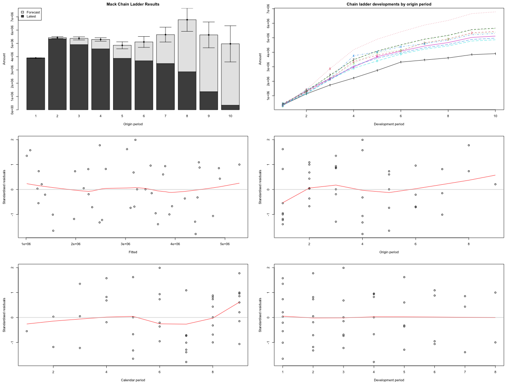

# Claims Reserving: Chain Ladder and Mack Chain Ladder (R)

## Project overview

This project applies actuarial reserving techniques to historical cumulative paid claims using R. The objective is to estimate ultimate claim payments, calculate the remaining unpaid claims reserve, and explore uncertainty in these estimates. The analysis uses the `GenIns` dataset supplied with the R package `ChainLadder`.

## Objectives

- Examine the pattern of cumulative paid claims across origin and development periods.
- Calculate volume-weighted age-to-age development factors and cumulative development factors (CDFs).
- Estimate ultimate claims and outstanding paid-claims reserves using the Chain Ladder method.
- Apply the Mack Chain Ladder model to assess reserve uncertainty and review diagnostic plots.

## Methodology

1. **Prepare the claims triangle:** Load the cumulative paid-claims triangle and identify the latest observed value for each origin period.
2. **Calculate development factors:** Use volume-weighted link ratios from origin periods observed at consecutive development ages.
3. **Estimate ultimate claims:** Multiply each origin period's latest paid claims by the relevant CDF.
4. **Calculate outstanding reserves:** Subtract paid claims to date from estimated ultimate claims. The script labels these estimates `IBNR`, following the reserving output convention.
5. **Assess uncertainty:** Fit `MackChainLadder` and inspect estimated standard errors and residual diagnostics.

The main calculations are:

$$
\text{Estimated ultimate claims} = \text{Latest paid claims} \times \text{CDF}
$$

$$
\text{Estimated outstanding claims reserve} = \text{Estimated ultimate claims} - \text{Latest paid claims}
$$

## Key results

The following results were obtained from the completed R analysis. Amounts are presented in the **dataset's monetary units**; no currency is assumed.

| Measure | Result |
|---|---:|
| Cumulative claims paid to date | 34,358,090 |
| Estimated ultimate claims | 53,038,946 |
| Estimated outstanding claims reserve (IBNR output) | **18,680,856** |
| Outstanding reserve as a share of estimated ultimate claims | 35.2% |
| Share of total outstanding reserve attributable to origin periods 8–10 | **68.7%** |

The manual Chain Ladder estimates agree with the Mack Chain Ladder **point estimates** (subject to rounding). The Mack model also produces reserve uncertainty estimates; these are not additional reserves to be added to the point estimates.

### 1. Cumulative claims development

Cumulative paid claims generally increase as each origin period develops. Different origin periods follow different development paths, demonstrating that historical claim payment patterns are not identical. The more recent origin periods have fewer observed development ages, so their ultimate claims require a larger degree of projection.

### 2. Estimated IBNR by origin period

The largest estimated outstanding reserves occur in the more recent origin periods:

| Origin period | Estimated outstanding reserve |
|---|---:|
| 8 | 3,920,301 |
| 9 | 4,278,972 |
| 10 | **4,625,811** |

Together, these three periods account for approximately **12.83 million (68.7%)** of the total outstanding reserve. This concentration is consistent with their limited observed development history, although it does not by itself establish that their underlying insured risks are higher.

Origin period 10 has a particularly high CDF of approximately **14.45**, so its ultimate claim estimate is sensitive to the assumed historical development pattern.

### 3. Mack Chain Ladder results and diagnostics

The Mack Chain Ladder analysis provides projected ultimate claims and estimates of reserve uncertainty. For example, origin period 10 has a Mack standard error of approximately **1.36 million** in the dataset's monetary units.

The standardised residual plots show values on both sides of zero, with some variation across fitted values, origin periods, calendar periods and development periods. These plots are useful for checking potential model issues, but visual inspection alone does **not** verify all of the Mack model assumptions.

## Conclusions

The analysis estimates ultimate claims of approximately **53.04 million**, compared with **34.36 million** paid to date, giving an estimated remaining paid-claims reserve of **18.68 million** in the dataset's monetary units. The most recent origin periods account for most of the outstanding reserve because their claims have had less time to develop.

The agreement between the manual Chain Ladder results and the Mack model's point estimates provides a useful **implementation consistency check**, rather than independent validation of predictive accuracy, because both use Chain Ladder point-estimation principles. Mack Chain Ladder adds an assessment of estimation uncertainty, reinforcing that a reserve is an estimate rather than a fixed future payment.

From an actuarial perspective, the project illustrates why claims development assumptions and data maturity are important when estimating reserves, and why the resulting estimates should be interpreted with caution.

## Limitations

- The `GenIns` data are a historical example dataset. Origin period numbers should not be presented as current calendar years.
- The model assumes **no further development after the last observed development age** (tail factor = 1). A different tail assumption could change estimated reserves.
- Chain Ladder assumes that historical development is a reasonable guide to future development. Changes in inflation, claims handling, settlement patterns or the insured portfolio could reduce its reliability.
- Because the input is a **paid-claims triangle**, the calculated outstanding amount includes future payments on both reported and unreported claims. This exercise does not separately estimate reported-but-not-paid case reserves and pure IBNR.
- Mack standard errors measure uncertainty under the model assumptions; they are not guaranteed prediction ranges and should not be added across origin periods to obtain a total standard error.

## Project files

- `claims_reserving.R` — R analysis and reserving models.
- `results/manual_chain_ladder.csv` — manual Chain Ladder estimates for each origin period.
- `results/mack_by_origin.csv` — Mack Chain Ladder estimates and uncertainty by origin period.
- `results/claims_development.png` — cumulative paid-claims development.
- `results/ibnr_by_origin.png` — outstanding reserves by origin period.
- `results/mack_diagnostics.png` — forecast and residual diagnostic plots.

## References

- [ChainLadder package documentation](https://mages.github.io/ChainLadder/articles/ChainLadder.html)
- [MackChainLadder function reference](https://mages.github.io/ChainLadder/reference/MackChainLadder.html)
